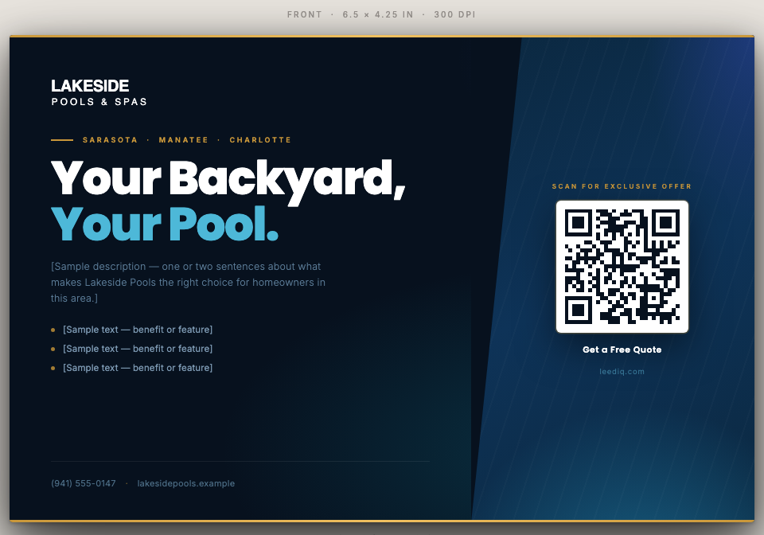
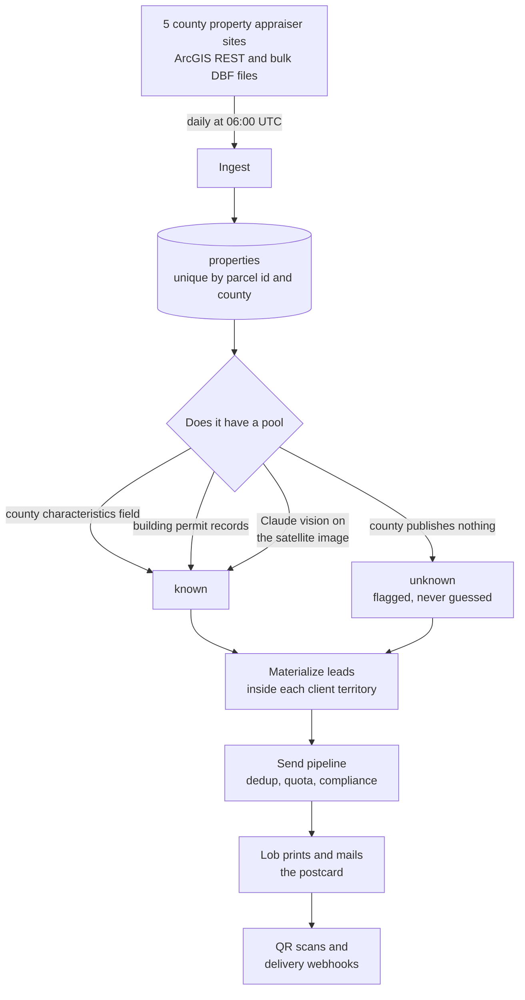

# LeedIQ

Direct mail for pool builders, sent only to houses that don't already have a pool.

Someone who just bought a house without a pool is about the best lead a pool builder can get. Florida counties publish every sale, so that list exists in public. The trouble is it comes from five county websites in five different shapes, and a good share of those houses already have a pool that nobody wrote down anywhere obvious.

LeedIQ pulls the records every morning, works out which houses actually lack a pool, and mails postcards to what's left.

[leediq.com](https://leediq.com). The admin panel sits behind a login.

This repo is a write-up. The code is private.

*The end of the pipeline: a 6.5 x 4.25 inch postcard, QR coded, ready for the mail provider. Brand shown is fictional.*

---

## How it runs

---

## Notes from building it

### Empty results looked exactly like quiet mornings

Each county scraper used to return an empty list when it found nothing. That reads the same as a day with no new sales, so nothing alerted. One county moved its domain and another started throwing intermittent 500s, and both outages ran for months before I caught them. Now a scraper that finds zero records throws instead of returning. The failures I worry about are the ones that look like normal days.

### "No pool" and "we don't know" aren't the same answer

Pool status comes from the county's own characteristics field, from permit history, from Claude looking at the satellite image, or from someone checking by hand. One county publishes no pool field at all. I could have stored `hasPool = false` for those and moved on, but then we mail a pool ad to somebody who is looking at their pool while they read it.

So I store where the answer came from next to the answer, and "this county doesn't publish it" is its own value, separate from "checked, no pool." Leads from that county get marked unverified and the client knows it.

### One county's firewall blocks anything script-shaped

Pinellas returns 403 to a default HTTP user agent. It took me two months to work that out, because the only symptom was no new leads from one county. Every scraper sends a browser user agent now, out of one shared constant so nobody forgets.

### Half a million rows don't fit in a serverless function

Two counties publish the whole county as one DBF file. Hillsborough is 531,000 records, and turning each one into an object costs about 2.5 GB, which kills the cron job. The fix was filtering during the parse, rejecting a record before it becomes an object, instead of parsing everything and filtering after.

### Mailing twice costs actual money

Three separate guards, because a duplicate here is a wasted dollar and an annoyed homeowner:

- An idempotency key per lead on the Lob call, so a retry returns the postcard that already printed.
- A 60 day dedup window across all clients, not just within one. Two pool builders in the same county shouldn't both land in the same mailbox the same week.
- Leads marked sent before the call, reverted if it fails, each send isolated so one bad address doesn't sink a batch of 200.

### A Postgres table instead of a queue service

Background jobs live in a `jobs` table, claimed with `FOR UPDATE SKIP LOCKED`, and leases that go stale get reset at the top of each cron run. No broker to run, no extra bill. Claiming safely under concurrency is the only genuinely hard part and Postgres does that for me. There's no exponential backoff and no dead letter queue yet, which I know I'll want eventually.

### The print renderer is not a browser

Lob renders the postcard to PDF in a headless browser with its own rules. PNG transparency comes out black. Its CSP won't load images from the blob store. Merge variables escape angle brackets, so you can't pass markup through them. So logos are inline SVG, images go through a proxy endpoint, and substitution happens before anything gets sent. The preview page runs the same merge code, so what you see there is what prints.

---

## Stack

Next.js 16 on Vercel, TypeScript in strict mode, Neon Postgres with Drizzle, JWT cookie sessions. Lob for print and mail, Stripe for subscriptions, Resend for email, Anthropic for vision and copy drafting, Vercel Cron and Blob, Sentry on top.

Multi-tenant in the application layer. Every query is scoped to a tenant, and each client carries its own branding, counties and plan limits.
